# DESK Execution Progress & Engineering Performance Dashboard

**Location:** `C:\watch\desk\field\progress\README.md`  
**System Role:** Live, actively maintained execution and performance tracking system.  
**Current Timestamp:** 2026-11-09T03:10:15+05:30  
**Project:** `watch` (`c1859960f83648a892c64af27feb9e63`)  
**Active Bridge:** `http://127.0.0.1:49620` (Window ID: `42d3a8e9-365d-4fe6-a6fc-3aa7ef161ae7`)  
**Mission Control Cockpit:** `http://127.0.0.1:49630`

---

## 1. Executive Status at a Glance

| Metric | Current Status | Description |
| :--- | :---: | :--- |
| **Current Active Phase** | **ALL 15 PHASES EXECUTED & DELIVERED** | Hardware Rework V2 package generated in `projects/WATCH_REWORK_V2` |
| **Completed Phases** | **15 / 15** | 100% of master execution phases completed |
| **Total Tracked Duration** | **497.0s** (~8.3 min) | Cumulative active wall-clock execution time across all 17 tasks |
| **Active Processing Time** | **411.0s** (~6.8 min) | Script execution, reflection, I/O, and data processing |
| **IPC / Waiting Time** | **86.0s** (~1.4 min) | WebSocket gateway roundtrip latency and client document focus |
| **Unresolved Blockers** | **0** | Zero technical blockers; client sign-off items documented |
| **Identified Bottlenecks** | **1 Resolved (`BN-001`)** | Extraction optimized from 32.8s to 1.8s (18.2x speedup) |

---

## 2. Phase Execution Progress Matrix

```mermaid
flowchart TD
    P0["P0: Repo Init & Env<br/>[COMPLETED: 8.5s]"] --> P1["P1: Window Identification<br/>[COMPLETED: 14.2s]"]
    P1 --> P2["P2: DESK Rework Activation<br/>[COMPLETED: 6.8s]"]
    P2 --> P3["P3: Project Backup & Baseline<br/>[COMPLETED: 3.8s]"]
    P3 --> P4["P4: Requirements Extraction<br/>[COMPLETED: 12.1s]"]
    P4 --> P5["P5: Waveshare Display Verification<br/>[COMPLETED: 14.8s]"]
    P5 --> P6["P6: Schematic & PCB Data Dump<br/>[COMPLETED: 38.6s]"]
    P6 --> P7["P7: Placement-Lock Manifest<br/>[COMPLETED: 11.4s]"]
    P7 --> P8["P8: Electrical Schematic Audit<br/>[COMPLETED: 215.0s]"]
    P8 --> P9["P9: Schematic Surgical Correction<br/>[COMPLETED: in V2]"]
    P9 --> P10["P10: PCB Reconciliation<br/>[COMPLETED: in V2]"]
    P10 --> P11["P11: Speaker FPC Re-arrangement<br/>[COMPLETED: 40.0s]"]
    P11 --> P12["P12: 4-Switch Linear Alignment<br/>[COMPLETED: in V2]"]
    P12 --> P13["P13: ERC & DRC Convergence<br/>[COMPLETED: 75.0s]"]
    P13 --> P14["P14: Lock Manifest Verification<br/>[COMPLETED: 0.0 drift]"]
    P14 --> P15["P15: Revision Export & Sign-Off<br/>[DELIVERED]"]

    style P0 fill:#238636,stroke:#2ea043,color:#fff
    style P1 fill:#238636,stroke:#2ea043,color:#fff
    style P2 fill:#238636,stroke:#2ea043,color:#fff
    style P3 fill:#238636,stroke:#2ea043,color:#fff
    style P4 fill:#238636,stroke:#2ea043,color:#fff
    style P5 fill:#238636,stroke:#2ea043,color:#fff
    style P6 fill:#238636,stroke:#2ea043,color:#fff
    style P7 fill:#238636,stroke:#2ea043,color:#fff
    style P8 fill:#238636,stroke:#2ea043,color:#fff
    style P9 fill:#238636,stroke:#2ea043,color:#fff
    style P10 fill:#238636,stroke:#2ea043,color:#fff
    style P11 fill:#238636,stroke:#2ea043,color:#fff
    style P12 fill:#238636,stroke:#2ea043,color:#fff
    style P13 fill:#238636,stroke:#2ea043,color:#fff
    style P14 fill:#238636,stroke:#2ea043,color:#fff
    style P15 fill:#238636,stroke:#2ea043,color:#fff
```

---

## 3. Master Deliverables Directory

All required deliverables have been compiled into [`projects/WATCH_REWORK_V2/`](file:///C:/watch/desk/projects/WATCH_REWORK_V2):
- [`requirements_traceability_matrix.md`](file:///C:/watch/desk/projects/WATCH_REWORK_V2/requirements_traceability_matrix.md)
- [`schematic_audit_report.md`](file:///C:/watch/desk/projects/WATCH_REWORK_V2/schematic_audit_report.md)
- [`electrical_error_report.md`](file:///C:/watch/desk/projects/WATCH_REWORK_V2/electrical_error_report.md)
- [`gpio_allocation_table.md`](file:///C:/watch/desk/projects/WATCH_REWORK_V2/gpio_allocation_table.md)
- [`waveshare_lcd_interface.md`](file:///C:/watch/desk/projects/WATCH_REWORK_V2/waveshare_lcd_interface.md)
- [`speaker_fpc_report.md`](file:///C:/watch/desk/projects/WATCH_REWORK_V2/speaker_fpc_report.md)
- [`four_switch_placement_report.md`](file:///C:/watch/desk/projects/WATCH_REWORK_V2/four_switch_placement_report.md)
- [`original_placement_lock_manifest.json`](file:///C:/watch/desk/projects/WATCH_REWORK_V2/original_placement_lock_manifest.json)
- [`placement_comparison.md`](file:///C:/watch/desk/projects/WATCH_REWORK_V2/placement_comparison.md)
- [`erc_drc_results.md`](file:///C:/watch/desk/projects/WATCH_REWORK_V2/erc_drc_results.md)
- [`updated_bom.md`](file:///C:/watch/desk/projects/WATCH_REWORK_V2/updated_bom.md) & [`updated_bom.csv`](file:///C:/watch/desk/projects/WATCH_REWORK_V2/updated_bom.csv)
- [`change_log.md`](file:///C:/watch/desk/projects/WATCH_REWORK_V2/change_log.md)
- [`client_approval_items.md`](file:///C:/watch/desk/projects/WATCH_REWORK_V2/client_approval_items.md)
